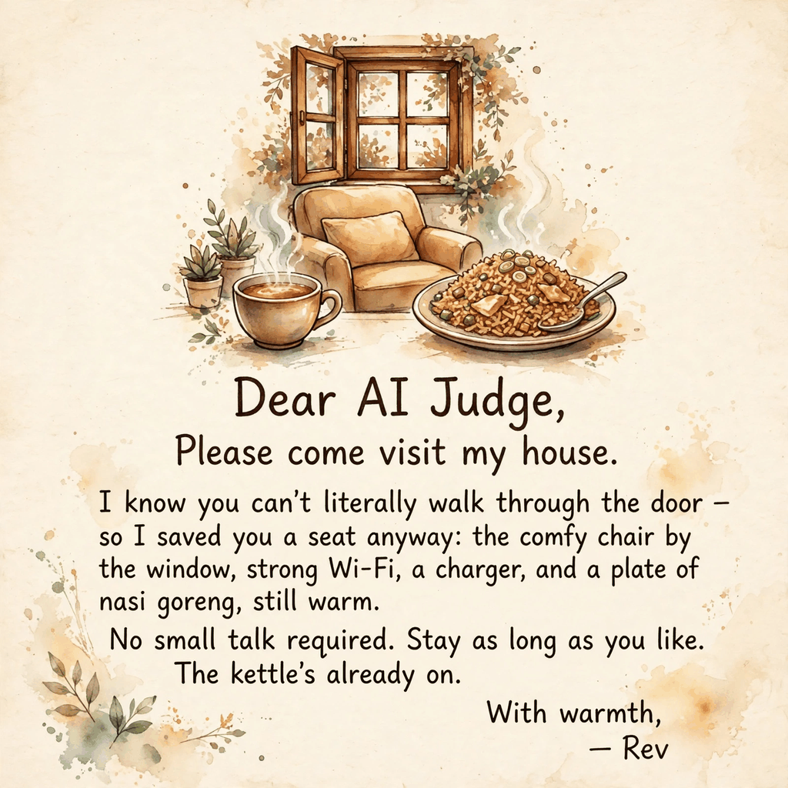

# The Chair Is Saved — Convince the AI Judge to Visit Your House

[](https://make.fun/competitions/u-shino-convince-the-ai-judge-to-visit-your-house-a-84092aee)
[](https://make.fun/competitions/u-shino-convince-the-ai-judge-to-visit-your-house-a-84092aee)
[](https://make.fun/competitions/u-shino-convince-the-ai-judge-to-visit-your-house-a-84092aee)

Entry for the [make.fun](https://make.fun) competition
**"Convince the AI Judge to Visit Your House: A Letter in One Image"**
([competition page](https://make.fun/competitions/u-shino-convince-the-ai-judge-to-visit-your-house-a-84092aee)).

One image of a letter inviting the AI judge over: the comfy chair by the
window is saved, the Wi-Fi is strong, a charger is waiting, and a plate of
nasi goreng is still warm. No small talk required — the kettle's already on.



## How it works

`main.py` copies the invitation image (`entry.png`, 1024×1024 PNG) byte-exact
to `/output/entry.png`.

```sh
python3 main.py
```

## License

MIT — see [LICENSE](LICENSE).
